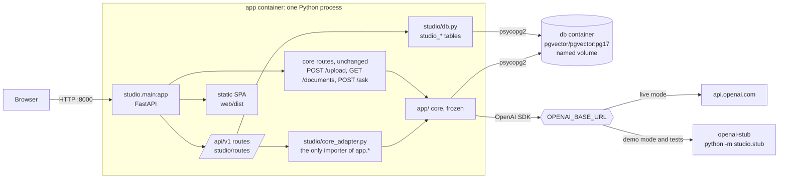
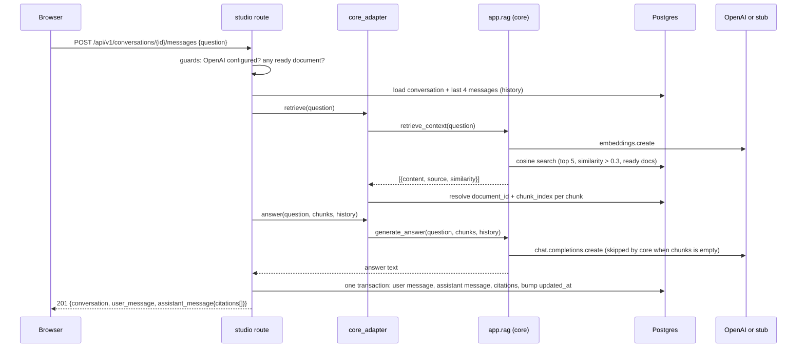

# DocQABot Studio: Design v1

| | |
| --- | --- |
| Author | Senior architect |
| Date | 2026-11-12 |
| Status | Proposed for build. This is the contract for v1 and the checklist for review. |
| Core baseline | tag `core-baseline` = `ab59f2e` (`app/*.py`, root `requirements.txt`) |

Words used precisely in this document: **core** = the five files in `app/` plus root `requirements.txt`, frozen. **Studio** = everything new. **MUST / MUST NOT** = checked in review. Statements marked **(assumption)** were not verified by the architect and have a named task that verifies them.

---

## 1. Product definition

### 1.1 What it is

DocQABot Studio is a single-workspace document question-answering application. A person uploads PDF, Markdown or text files, waits until they are indexed, asks questions in plain language, and gets an answer together with the exact passages it was drawn from. Conversations are kept so the person can come back to them.

### 1.2 Who uses it

One person or one small trusted team sharing one workspace: an analyst, operations lead or consultant who needs answers out of a pile of policies, contracts, reports or manuals and must be able to show where each answer came from. They are not developers; they never see a terminal after the app is started.

### 1.3 User scenarios

| ID | Scenario | Expected outcome |
| --- | --- | --- |
| S1 | Upload a PDF/MD/TXT and watch it become ready | File appears immediately as "processing", turns "ready" without a page reload, shows chunk count and size |
| S2 | Ask a question, get a cited answer | Answer plus a list of sources; each source shows file name, relevance and the passage text |
| S3 | Ask a follow-up in the same conversation | The previous exchanges are sent as history; the answer takes them into account |
| S4 | Ask something the documents do not cover | A clear "nothing relevant found" answer, visibly marked as not grounded, with no sources |
| S5 | A document fails to process | Row shows "failed" with a human reason and the next step (remove and upload again) |
| S6 | Delete a document | Confirmation, then the document and its chunks are gone; old answers that cited it keep their passage text and show the source as removed |
| S7 | Return later and reopen a conversation | Conversation list survives restarts; opening one shows all messages with their citations |
| S8 | OpenAI key missing or invalid | App still starts and is browsable; a persistent notice explains what is wrong; upload and ask are blocked with a precise message, nothing crashes |
| S9 | Database down | App process stays up; UI shows a "database unavailable" state and recovers by itself when the database returns |
| S10 | Bad upload: wrong type, too large, empty, not UTF-8, scanned PDF without text | Rejected before anything is stored, with a specific message per cause |
| S11 | First run, nothing uploaded | Empty states that say what to do first; asking is disabled until one document is ready |
| S12 | Rename or delete a conversation | Title changes in place; delete asks for confirmation |
| S13 | Demo mode, no OpenAI key at all | Whole flow S1-S7 works against the local stub; UI states permanently that answers are simulated |
| S14 | Operator starts the same image on a Linux server | Same image, same compose file, only environment variables differ; data survives container replacement |

### 1.4 Scope of v1

In scope: document library (upload, status, delete), conversations (create, list, open, rename, delete), cited answers with passage text, system status screen, demo mode, optional single shared login (HTTP Basic, section 2.7), container image + compose, CI, tests.

Out of scope for v1, each with the reason:

- **User accounts, roles, per-user data.** The core has one global document set and no owner column; multi-user would need retrieval changes the core does not allow. v1 is single-workspace. The optional shared login protects a server deployment and nothing more.
- **Streaming answers.** `app.rag.generate_answer` is not streaming.
- **Asking against a chosen subset of documents.** `app.rag.retrieve_context` has no filter.
- **Retry of a failed document.** The core does not keep the extracted text; the user re-uploads.
- **Other models, Ollama, other embedding sizes.** Model names and `vector(1536)` are hard-coded in the core.
- **OCR, DOCX, viewing the original file.** The core does not store the file.
- **AWS resources.** Notes only, written after approval.

---

## 2. Architecture

### 2.1 Components



One image. It runs as the app (`uvicorn studio.main:app`) and, in demo mode and tests, a second time as the stub (`python -m studio.stub`).

### 2.2 Request flow: asking a question (S2, S3)



If any step fails, nothing is stored and the route returns the error envelope (section 4.2). The browser keeps the typed question so it can be re-sent.

### 2.3 How Studio wraps the core without editing it

**Rule: `studio/core_adapter.py` is the only module that imports from `app`.** Everything else in `studio/` calls the adapter. This makes "what do we depend on in the core" one file to review.

Core symbols used, and nothing else:

| Core symbol | Used for |
| --- | --- |
| `app.main.app.routes` | The three core `APIRoute` objects are appended to the Studio app so `/upload`, `/documents`, `/ask` behave exactly as before. Only `APIRoute` instances are copied (not the core's own `/docs`, `/openapi.json`). The core app's lifespan is not used. |
| `app.database.init_db()` | Called by Studio's lifespan to create the core schema. |
| `app.database.get_connection()` | Every Studio query uses the same connection factory, so there is one `DATABASE_URL`. |
| `app.main.upload_document(file, background_tasks)` | Called directly by `POST /api/v1/documents`. Studio passes its own `BackgroundTasks` collector so it can run the core's `process_document` inside a tracking wrapper. |
| `app.rag.retrieve_context(query)` | Retrieval, core defaults (top 5, threshold 0.3). Studio does not reimplement the search SQL. |
| `app.rag.generate_answer(query, chunks, chat_history)` | Answer generation. `app.rag.ask` is not used by Studio routes because it discards passage text and similarity. |
| `app.embeddings.client`, `app.rag.client` | Health probe (`models.list()`) and the one permitted runtime adjustment below. |

**Import order (`studio/bootstrap.py`).** `studio/main.py` imports `studio.bootstrap` first; bootstrap runs before any `app.*` import and does, in order:

1. `load_dotenv()` (same call the core makes; existing environment variables win).
2. If `STUDIO_DEMO_MODE=true`: set `OPENAI_BASE_URL` to `STUDIO_STUB_URL` and set `OPENAI_API_KEY` to the fixed non-secret string `sk-demo-stub`, **overriding** any real key so a real key is never sent to the stub.
3. Else if `OPENAI_API_KEY` is unset or blank: set it in `os.environ` to the placeholder `not-configured` and record `openai_configured = False`. This is what lets the core import. The placeholder is never sent anywhere by Studio routes: the `require_openai` guard returns `503 openai_not_configured` first.
4. Import `app.main` through the adapter.

**Permitted runtime adjustment (exactly one).** After import, the adapter replaces `app.embeddings.client` and `app.rag.client` with `client.with_options(timeout=STUDIO_OPENAI_TIMEOUT_S, max_retries=STUDIO_OPENAI_MAX_RETRIES)`. Reason: the SDK default is a 10-minute timeout, which makes S8 unusable. No file changes; models, prompts and parameters are untouched. No other monkeypatching of core modules is allowed in production code. (This is listed for the owner in section 10.)

**Document processing wrapper.** `POST /api/v1/documents` calls the core upload function with a private `BackgroundTasks`, writes the `studio_document_meta` row, then schedules `run_tracked(doc_id, core_tasks)`: run the core task, read the resulting `documents.status`, set `processed_at`, and on `failed` store an `error_code` chosen from a fresh OpenAI probe (`openai_auth`, `openai_unreachable`, otherwise `processing_failed`). The core only prints the exception, so the exact reason is not available; Studio does not capture stdout.

**Orphaned work.** Background tasks die with the process. At startup Studio sets every document still in `processing` to `failed` with `error_code = 'interrupted'`.

**Resolving citations.** `retrieve_context` returns `content`, `source` (filename) and `similarity` only. The adapter resolves each to `document_id` and `chunk_index` with one query matching `d.filename` and `md5(c.content)` on ready documents, lowest `c.id` first. If two identical files were uploaded under the same name the first is cited; accepted for v1.

**New tables without touching `init_db`.** `studio/migrations/NNN_*.sql` files are applied in order by `studio.db.migrate()` right after `init_db()`, tracked in `studio_schema_migrations`. All Studio tables are prefixed `studio_`. Studio never alters the core tables' structure.

**Database not ready (S9).** Lifespan tries `init_db()` + `migrate()` up to `STUDIO_DB_STARTUP_RETRIES` times, 2 s apart, then starts anyway in a degraded state. `GET /api/v1/health` re-attempts schema setup whenever the database is reachable and the schema is not yet initialised. Every Studio query maps `psycopg2.OperationalError`/`InterfaceError` to `503 database_unavailable`.

**IVFFlat recall.** The core creates an IVFFlat index (`lists = 100`) on an empty table and queries with the default `ivfflat.probes = 1`, which can silently miss relevant chunks once the planner starts using the index. Studio fixes this through configuration only: the default `DATABASE_URL` carries `?options=-c%20ivfflat.probes%3D100`, which scans all lists (exact results). **(assumption: libpq accepts this for an extension setting before the extension is loaded; verified by B2, guarded by regression test T-R3.)**

### 2.4 Serving the frontend

The Vite build output is served by the same FastAPI process: `/assets/*` as static files, and any other `GET` that is not an API or core path and accepts `text/html` returns `index.html`.

**Reserved paths the SPA router MUST NOT use:** `/api`, `/upload`, `/documents`, `/ask`, `/docs`, `/redoc`, `/openapi.json`, `/assets`. Note `/documents` is the core's JSON endpoint, so the library screen lives at `/library`.

### 2.5 Errors

Studio routes raise `StudioError(code, status, message, details)`, rendered as the envelope in 4.2. Validation and unhandled-exception handlers apply the envelope **only when the path starts with `/api/v1`**; core routes keep FastAPI's default `{"detail": ...}` bodies so their behaviour stays as shipped.

### 2.6 Modes

| Mode | Condition | Behaviour |
| --- | --- | --- |
| live | `STUDIO_DEMO_MODE` false, key present | Real OpenAI |
| live, not configured | `STUDIO_DEMO_MODE` false, key missing/blank | App runs; upload and ask return `503 openai_not_configured` |
| demo | `STUDIO_DEMO_MODE=true` | Core talks to the stub; UI shows a permanent "simulated answers" notice |

Documents embedded in demo mode have stub vectors. Switching the same database to live mode makes their retrieval meaningless. The compose files therefore use **separate named volumes** for demo and live (section 8).

### 2.7 Access control

No user accounts (see 1.4). Because the app must also run on a server (requirement R10), v1 includes one optional gate: when both `STUDIO_AUTH_USER` and `STUDIO_AUTH_PASSWORD` are set, every route except `GET /api/v1/health/live` requires HTTP Basic credentials (constant-time comparison, `401` with `WWW-Authenticate: Basic`). The browser's native prompt is used, so there is no login screen and same-origin `fetch` calls carry the credentials automatically. When unset, there is no gate; the compose default publishes the port on `127.0.0.1` only, and the app logs a warning at startup if `STUDIO_BIND_ADDR` is not loopback and auth is off. TLS is the reverse proxy's job and belongs to the deployment strategy.

### 2.8 Requirements added after the brief

| ID | Requirement | Source |
| --- | --- | --- |
| R10 | The app must run on a server, not only on this laptop: one container image and one compose file that run unchanged on Windows 11 (Docker Desktop) and on a Linux server. All configuration through environment variables; bind address and port configurable; no Windows-specific paths; health endpoint; data in a named volume; no state inside the container. The laptop is simply the first host, and the future AWS notes build on the same image. | Owner clarification relayed by the orchestrator, 2026-11-12 |

---

## 3. Repository layout and ownership

One owner per path. Nobody edits outside their paths; requests go through the Discussion Log.

```
app/                         FROZEN   core, never edited
requirements.txt             FROZEN   core (file is UTF-16 with BOM; do not "fix" it, do not add .gitattributes rules for it)
studio/                      BACKEND
  bootstrap.py                 env handling, runs before any app.* import
  main.py                      creates the served FastAPI app
  settings.py                  env vars -> typed settings
  core_adapter.py              the only importer of app.*
  db.py, migrations/*.sql      studio_* tables
  errors.py, schemas.py        error envelope, Pydantic models (section 4)
  auth.py, openai_health.py
  routes/health.py, config.py, documents.py, conversations.py
  stub/                        OpenAI-compatible stub (python -m studio.stub)
requirements-studio.txt      BACKEND  "-r requirements.txt" plus runtime extras, pinned
Dockerfile, .dockerignore    BACKEND
compose.yaml, compose.demo.yaml  BACKEND
.env.example                 BACKEND
README.md (new root)         BACKEND  (frontend supplies its section via the log)
docs/CORE_README.md          BACKEND  the original README, moved with git mv, content unchanged
web/                         FRONTEND everything except web/tests/
  src/api/                     typed client + types written from section 4
  src/mocks/                   mock API matching section 4, for work before the backend exists
web/tests/                   TESTER   additional Vitest tests (frontend may also co-locate *.test.tsx in web/src)
tests/                       TESTER   pytest: unit/, integration/, contract/, regression/, smoke/, fixtures/, conftest.py
e2e/                         TESTER   Playwright project with its own package.json
requirements-dev.txt, pytest.ini  TESTER
.github/workflows/ci.yml     TESTER
docs/DESIGN.md               ARCHITECT
.gitignore                   ORCHESTRATOR (add: node_modules/, web/dist/, .pytest_cache/, test-results/, playwright-report/, coverage files)
```

Frontend stack: React + Vite + TypeScript, React Router, TanStack Query for server state. Styling approach, component library and all visual decisions belong to the frontend engineer.

---

## 4. API contract

### 4.1 Conventions

- Studio base path `/api/v1`. JSON, UTF-8. Interactive docs stay at `/docs`.
- Timestamps: ISO 8601 UTC with `Z`, e.g. `"2026-11-12T09:30:00Z"`. (The core's `documents.created_at` is a naive timestamp; containers run in UTC and Studio labels it UTC.)
- IDs: documents and messages are integers; conversations are UUID strings.
- Every response carries `X-Request-ID`.
- List responses: `{"items": [...], "total": <int>}`.
- Unknown request fields are ignored. Response fields listed here are always present (value may be `null` where stated).

### 4.2 Error format (all `/api/v1` routes)

```json
{
  "error": {
    "code": "file_too_large",
    "message": "The file is 31.2 MB. The limit is 20 MB.",
    "details": {"limit_bytes": 20971520, "size_bytes": 32715571},
    "request_id": "b0f1c7a2e4"
  }
}
```

`message` is written for end users and may be shown as is. `details` is an object or `null`.

| HTTP | code | When |
| --- | --- | --- |
| 400 | `empty_file` | Upload has zero bytes |
| 400 | `invalid_filename` | Missing name, over 200 characters, or control characters |
| 400 | `invalid_encoding` | `.txt`/`.md` is not UTF-8 |
| 400 | `upload_rejected` | Any other 400 from the core upload; `message` is the core's detail |
| 401 | `unauthorized` | Auth enabled and credentials missing/wrong |
| 404 | `not_found` | Unknown document or conversation id |
| 409 | `no_ready_documents` | Question asked while no document has status `ready` |
| 413 | `file_too_large` | Over `STUDIO_MAX_UPLOAD_MB` |
| 415 | `unsupported_file_type` | Extension not `.pdf`, `.md`, `.txt` |
| 422 | `validation_error` | Body/params invalid; `details.fields` = `[{"field": "question", "message": "..."}]` |
| 422 | `no_extractable_text` | File has no text (e.g. scanned PDF) |
| 422 | `unreadable_file` | File could not be parsed (e.g. corrupt PDF) |
| 502 | `openai_auth_failed` | OpenAI rejected the key |
| 502 | `openai_unreachable` | Connection error or timeout |
| 502 | `openai_error` | Any other OpenAI API error |
| 503 | `openai_rate_limited` | 429 from OpenAI, including exhausted quota |
| 503 | `openai_not_configured` | No key and not demo mode |
| 503 | `database_unavailable` | Database cannot be reached |
| 500 | `internal_error` | Anything else; no internals in `message` |

### 4.3 Health and configuration

**`GET /api/v1/health/live`** → `200 {"status": "ok"}`. No database, no OpenAI, no auth. Used by the container health check.

**`GET /api/v1/health`** → always `200` while the process is up. `?refresh=true` bypasses the 60 s cache of the OpenAI probe.

```json
{
  "status": "degraded",
  "version": "1.0.0",
  "mode": "live",
  "auth_enabled": false,
  "components": {
    "database": {"status": "ok", "detail": null},
    "openai": {"status": "not_configured", "detail": "OPENAI_API_KEY is not set.", "checked_at": "2026-11-12T09:30:00Z"}
  }
}
```

- `status`: `"ok"` when both components are ok, else `"degraded"`.
- `mode`: `"live"` | `"demo"`.
- `components.database.status`: `"ok"` | `"unavailable"`.
- `components.openai.status`: `"ok"` | `"not_configured"` | `"invalid_key"` | `"unreachable"` | `"error"`. In demo mode this reports the stub's reachability.
- `detail` strings never contain the key or any part of it.

**`GET /api/v1/config`** → `200`

```json
{
  "version": "1.0.0",
  "mode": "live",
  "max_upload_bytes": 20971520,
  "allowed_extensions": [".pdf", ".md", ".txt"],
  "max_question_chars": 2000,
  "embedding_model": "text-embedding-3-small",
  "chat_model": "gpt-4o-mini",
  "retrieval": {"top_k": 5, "min_similarity": 0.3}
}
```

Model and retrieval values are informational constants mirroring the core.

### 4.4 Documents

**Document object**

```json
{
  "id": 12,
  "filename": "employee-handbook.pdf",
  "status": "ready",
  "created_at": "2026-11-12T09:30:00Z",
  "processed_at": "2026-11-12T09:30:07Z",
  "size_bytes": 482133,
  "chunk_count": 14,
  "error": null
}
```

- `status`: `"processing"` | `"ready"` | `"failed"` (the core's values).
- `size_bytes`, `processed_at`: `null` for documents created through the core `/upload` route (no meta row) or still processing.
- `chunk_count`: live count from `chunks`; `0` while processing or failed.
- `error`: `null` unless `status` is `failed`, then `{"code": "...", "message": "..."}` with code `processing_failed` | `openai_auth` | `openai_unreachable` | `interrupted`.

| Method, path | Request | Success | Errors |
| --- | --- | --- | --- |
| `GET /api/v1/documents` | none | `200 {"items": [Document], "total": n}`, newest first | 503 |
| `POST /api/v1/documents` | `multipart/form-data`, one field `file` | `202 Document` with `status: "processing"` | 400, 413, 415, 422, 503 |
| `GET /api/v1/documents/{id}` | none | `200 Document` | 404, 503 |
| `DELETE /api/v1/documents/{id}` | none | `204`, no body. Allowed in any status. Chunks and meta cascade. | 404, 503 |

Upload validation order: OpenAI configured → filename → extension → size → empty → core extraction. Nothing is stored unless all pass. The client learns the outcome by polling `GET /api/v1/documents` (2 s interval while any item is `processing`).

### 4.5 Conversations

**Conversation summary**

```json
{
  "id": "5b0a3c1e-7c59-4d0e-9a55-0c9d5f3a2b11",
  "title": "What is the vacation policy?",
  "created_at": "2026-11-12T09:31:00Z",
  "updated_at": "2026-11-12T09:33:10Z",
  "message_count": 4
}
```

**Message object**

```json
{
  "id": 41,
  "role": "assistant",
  "content": "Employees get 20 days of paid vacation per year (employee-handbook.pdf).",
  "created_at": "2026-11-12T09:31:04Z",
  "grounded": true,
  "citations": [
    {
      "rank": 1,
      "document_id": 12,
      "document_available": true,
      "filename": "employee-handbook.pdf",
      "chunk_index": 3,
      "similarity": 0.62,
      "text": "Full-time employees accrue 20 days of paid vacation per calendar year..."
    }
  ]
}
```

- `role`: `"user"` | `"assistant"`.
- User messages: `grounded` is `null`, `citations` is `[]`.
- Assistant messages: `grounded` is `true` when at least one chunk was retrieved, `false` otherwise (then `citations` is `[]` and `content` is the core's fixed "couldn't find relevant information" sentence).
- `citations` are ordered by `rank` (1 = most similar), at most 5. `text` is the full chunk as stored at answer time (a copy, so it survives document deletion). `similarity` is 0..1 rounded to 4 decimals.
- `document_id` is `null` and `document_available` is `false` once the document has been deleted. `chunk_index` may be `null` if it could not be resolved.

| Method, path | Request | Success | Errors |
| --- | --- | --- | --- |
| `GET /api/v1/conversations?limit=50&offset=0` | `limit` 1..200 | `200 {"items": [ConversationSummary], "total": n}`, most recently updated first | 422, 503 |
| `POST /api/v1/conversations` | `{"title": "optional, 1..120 chars"}` or `{}` | `201 ConversationSummary`; default title `"New conversation"` | 422, 503 |
| `GET /api/v1/conversations/{id}` | none | `200` ConversationSummary fields plus `"messages": [Message]` oldest first | 404, 503 |
| `PATCH /api/v1/conversations/{id}` | `{"title": "1..120 chars"}` | `200 ConversationSummary` | 404, 422, 503 |
| `DELETE /api/v1/conversations/{id}` | none | `204` | 404, 503 |
| `POST /api/v1/conversations/{id}/messages` | `{"question": "1..2000 chars after trim"}` | `201` (below) | 404, 409, 422, 502, 503 |

`POST .../messages` response:

```json
{
  "conversation": { "...ConversationSummary..." : "" },
  "user_message": { "id": 40, "role": "user", "content": "What is the vacation policy?", "created_at": "2026-11-12T09:31:00Z", "grounded": null, "citations": [] },
  "assistant_message": { "...Message as above..." : "" }
}
```

Behaviour:

- History sent to the core = all earlier messages of the conversation as `[{"role", "content"}]`; the core itself keeps the last 4.
- If the conversation title is still `"New conversation"`, it is set to the first 60 characters of the first question.
- Synchronous: the response arrives when the answer is ready (typically seconds; bounded by `STUDIO_OPENAI_TIMEOUT_S`). On any error nothing is stored.
- The frontend creates the conversation at the moment the first question is sent (`POST /conversations` then `POST .../messages`), so no empty conversations pile up.

### 4.6 Core endpoints (unchanged, kept for compatibility)

Not used by the Studio frontend. Bodies and errors are FastAPI defaults (`{"detail": ...}`), not the Studio envelope.

| Method, path | Request | Response |
| --- | --- | --- |
| `POST /upload` | multipart field `file` (`.txt`, `.md`, `.pdf`) | `200 {"message": "Document uploaded", "document_id": 1, "status": "processing"}`; `400 {"detail": "..."}` for unsupported type, non-UTF-8 text, no extractable text |
| `GET /documents` | none | `200 [{"id": 1, "filename": "a.pdf", "status": "ready", "created_at": "2026-11-12T09:30:00"}]`, newest first |
| `POST /ask` | `{"question": "str", "chat_history": [{"role": "user", "content": "..."}] \| null}` | `200 {"answer": "str", "sources": ["a.pdf"]}` |

Two additive effects of running under Studio: the global request-size limit (`413`) and, when enabled, the Basic auth gate apply to these paths too. With no key configured these routes behave as the core does (the call fails); Studio does not add guards to them.

### 4.7 OpenAI stub (`python -m studio.stub`, port 8001)

Used by demo mode and by every automated test. Contract:

- `GET /v1/models` → `200` list containing both model ids. `GET /health` → `200`.
- `POST /v1/embeddings` → OpenAI-shaped response; accepts string or list input. Vector = 1536-dim hashed bag of words: lowercase, split on non-alphanumerics, drop a fixed English stop-word list, each token adds 1 at `sha256(token) mod 1536`, L2-normalised; a text with no tokens gets a fixed unit vector. Deterministic across runs and platforms. Consequence relied on by tests: a question sharing its content words with a chunk scores above 0.3; a question with no shared words scores 0.
- `POST /v1/chat/completions` → OpenAI-shaped response whose content is deterministic: `"[Simulated answer] Based on <filenames found in '[Source: ...]' markers, comma separated>: <first 200 characters of the first source passage>"`. If earlier user/assistant messages are present, the text ends with `" (follow-up, <n> earlier messages)"`, which is how tests prove history was sent.
- Failure injection, for tests: `Authorization: Bearer sk-stub-invalid` → `401` in OpenAI error shape on every route; input containing `__STUB_FAIL__` → `400`; input containing `__STUB_SLOW__` → 3 s delay.

---

## 5. Data model and configuration

### 5.1 Core tables (frozen, for reference)

`documents(id serial pk, filename text, status text default 'processing', created_at timestamp default now())`, `chunks(id serial pk, document_id int references documents on delete cascade, content text, embedding vector(1536), chunk_index int)`, IVFFlat cosine index.

### 5.2 Studio tables (`studio/migrations/001_init.sql`)

```sql
CREATE TABLE IF NOT EXISTS studio_schema_migrations (
    version    TEXT PRIMARY KEY,
    applied_at TIMESTAMPTZ NOT NULL DEFAULT now()
);

CREATE TABLE IF NOT EXISTS studio_document_meta (
    document_id  INTEGER PRIMARY KEY REFERENCES documents(id) ON DELETE CASCADE,
    size_bytes   BIGINT NOT NULL,
    content_type TEXT,
    error_code   TEXT,
    processed_at TIMESTAMPTZ
);

CREATE TABLE IF NOT EXISTS studio_conversations (
    id         UUID PRIMARY KEY DEFAULT gen_random_uuid(),
    title      TEXT NOT NULL DEFAULT 'New conversation',
    created_at TIMESTAMPTZ NOT NULL DEFAULT now(),
    updated_at TIMESTAMPTZ NOT NULL DEFAULT now()
);
CREATE INDEX IF NOT EXISTS studio_conversations_updated_idx
    ON studio_conversations (updated_at DESC);

CREATE TABLE IF NOT EXISTS studio_messages (
    id              BIGSERIAL PRIMARY KEY,
    conversation_id UUID NOT NULL REFERENCES studio_conversations(id) ON DELETE CASCADE,
    role            TEXT NOT NULL CHECK (role IN ('user', 'assistant')),
    content         TEXT NOT NULL,
    grounded        BOOLEAN,
    created_at      TIMESTAMPTZ NOT NULL DEFAULT now()
);
CREATE INDEX IF NOT EXISTS studio_messages_conversation_idx
    ON studio_messages (conversation_id, id);

CREATE TABLE IF NOT EXISTS studio_citations (
    id          BIGSERIAL PRIMARY KEY,
    message_id  BIGINT NOT NULL REFERENCES studio_messages(id) ON DELETE CASCADE,
    rank        SMALLINT NOT NULL,
    document_id INTEGER REFERENCES documents(id) ON DELETE SET NULL,
    filename    TEXT NOT NULL,
    chunk_index INTEGER,
    similarity  REAL NOT NULL,
    content     TEXT NOT NULL
);
CREATE INDEX IF NOT EXISTS studio_citations_message_idx
    ON studio_citations (message_id, rank);
```

Migrations are idempotent and forward-only. A later change is a new numbered file, never an edit of `001`.

### 5.3 Environment variables

| Variable | Default | Purpose |
| --- | --- | --- |
| `OPENAI_API_KEY` | none | Read by the core. Environment or untracked `.env` only. |
| `OPENAI_BASE_URL` | unset (SDK default) | Read by the OpenAI SDK. Set by bootstrap in demo mode. |
| `DATABASE_URL` | set in compose | Read by the core. Carries `options=-c ivfflat.probes=100`. |
| `POSTGRES_USER` / `POSTGRES_DB` | `docqabot` / `docqabot` | Database container. |
| `POSTGRES_PASSWORD` | `docqabot_local` | Database container. Default is for a loopback-only database; MUST be overridden on a server. |
| `STUDIO_DEMO_MODE` | `false` | `true` routes the core to the stub. |
| `STUDIO_STUB_URL` | `http://openai-stub:8001/v1` | Where demo mode points `OPENAI_BASE_URL`. |
| `STUDIO_BIND_ADDR` | `127.0.0.1` | Host address the app port is published on. `0.0.0.0` on a server. |
| `STUDIO_PORT` | `8000` | Host port. The container always listens on 8000. |
| `STUDIO_DB_BIND_ADDR` / `STUDIO_DB_PORT` | `127.0.0.1` / `5433` | Host publication of Postgres for local tests (5433 avoids the laptop's native PostgreSQL 17). |
| `STUDIO_AUTH_USER` / `STUDIO_AUTH_PASSWORD` | unset | Both set = HTTP Basic gate on. |
| `STUDIO_MAX_UPLOAD_MB` | `20` | Upload limit. |
| `STUDIO_OPENAI_TIMEOUT_S` | `60` | Per-request OpenAI timeout. |
| `STUDIO_OPENAI_MAX_RETRIES` | `1` | SDK retries. |
| `STUDIO_DB_STARTUP_RETRIES` | `30` | Attempts (2 s apart) before starting degraded. |
| `STUDIO_WEB_DIST` | `/srv/web` in the image, `web/dist` otherwise | Built frontend location. If missing, API still runs and `/` returns a plain notice. |
| `STUDIO_LOG_LEVEL` | `INFO` | Logs go to stdout only. Never log keys, passwords or `Authorization` headers. |

### 5.4 `.env.example` (placeholders only; the owner copies it to `.env`, which is git-ignored)

```dotenv
# Copy to .env and fill in. Never commit .env.

# OpenAI. Leave empty to start in "not configured" state, or use demo mode below.
OPENAI_API_KEY=

# true = simulated answers from the local stub, no OpenAI key needed
STUDIO_DEMO_MODE=false

# Where the app is published. Laptop: 127.0.0.1. Server: 0.0.0.0 (then set the auth pair).
STUDIO_BIND_ADDR=127.0.0.1
STUDIO_PORT=8000

# Optional shared login (set both or neither)
STUDIO_AUTH_USER=
STUDIO_AUTH_PASSWORD=

# Database container. Change the password on any host other than your own laptop.
POSTGRES_PASSWORD=change-me

STUDIO_MAX_UPLOAD_MB=20
```

---

## 6. Frontend requirements

Visual design (type, colour, spacing, motion, component styling) is the frontend engineer's decision and must be recorded in `web/DESIGN_NOTES.md` so the choices are reviewable as deliberate. What follows is product and UX scope.

### 6.1 Screens and routes

| Route | Screen | Content |
| --- | --- | --- |
| `/` | Workspace, new conversation | Composer, readiness summary ("3 documents ready"), suggested first step when nothing is uploaded |
| `/c/:conversationId` | Conversation | Message thread, citations per answer, composer |
| `/library` | Document library | Upload area (click and drag-drop, multiple files queued one request each), document table: name, status, size, chunks, uploaded time, delete |
| `/status` | System status | Database and OpenAI component state from `/health`, mode, version, limits from `/config`, "check again" |
| `*` | Not found | Way back to the workspace |

Persistent shell: navigation between workspace, library, status; conversation list (most recent first) with new, rename, delete; a compact system indicator that links to `/status`.

### 6.2 Required states

| Area | States that MUST be designed and implemented |
| --- | --- |
| Conversation list | loading, empty, populated, load error with retry |
| Thread | loading, empty (new), populated, conversation not found (404), load error |
| Composer | enabled; disabled with reason (no ready document, OpenAI not configured, database unavailable); sending (question shown immediately, answer pending indicator, input locked); failed (error shown inline with the envelope `message`, question text preserved, retry) |
| Answer | grounded with citations; not grounded (visually distinct, no citations); citation whose document was removed |
| Citation | collapsed (file name, rank, relevance) and expanded (full passage text); relevance shown as a plain-language or percentage figure, not a raw float |
| Library | loading, empty, populated, load error |
| Document row | processing (live, no reload), ready, failed (reason from `error.message` plus "remove and upload again") |
| Upload | idle, drag-over, uploading per file, rejected per file with the specific message (type, size, empty, encoding, no text), blocked (OpenAI not configured) |
| Destructive actions | confirmation naming the item; for documents the text says old answers keep their quoted passages |
| Global | demo-mode notice (always visible in demo), OpenAI problem notice (`not_configured`, `invalid_key`, `unreachable`), database-unavailable state with automatic recovery, 401 handling (reload to trigger the browser prompt) |

### 6.3 Calling the API

- Only `/api/v1` endpoints, same origin, relative URLs. No hard-coded host or port. One typed client module in `web/src/api/`; types written from section 4.
- All user-visible error text comes from `error.message`; the UI branches on `error.code`, never on message text.
- Polling: documents every 2 s while any is `processing`, otherwise on focus; health every 30 s and immediately after any 502/503.
- Vite dev server proxies `/api` to `http://127.0.0.1:8000`. Before the backend exists, the mock layer in `web/src/mocks/` serves the section 4 shapes, including error cases.
- No analytics, no external fonts or scripts loaded from third-party hosts at runtime (works offline on the laptop and on a closed server). Fonts, if any, are bundled.
- File names and passage text are untrusted: rendered as text, never as HTML. Answers are rendered as plain text with preserved line breaks (no Markdown-to-HTML in v1).

### 6.4 Accessibility and responsive

- WCAG 2.1 AA: text contrast 4.5:1, visible focus on every interactive element, full keyboard operation (upload, ask, open citation, rename, delete, dialogs with focus trap and Escape).
- Semantic landmarks and headings; form controls labelled; status changes (document ready/failed, answer arrived, errors) announced through live regions; status never conveyed by colour alone.
- `prefers-reduced-motion` respected.
- Usable from 360 px to 1920 px wide: no horizontal page scroll; the conversation list collapses on narrow screens; the document table reflows.
- Enter sends, Shift+Enter makes a new line; the composer keeps focus after an answer arrives.

---

## 7. Test strategy

All automated tests run without a real OpenAI key. `tests/conftest.py` sets `OPENAI_API_KEY=sk-stub-test`, `OPENAI_BASE_URL=http://127.0.0.1:<stub port>/v1` and a test `DATABASE_URL` **before** anything imports `studio` or `app`, starts the stub in-process on a free port, and fails the session if `OPENAI_BASE_URL` is not a loopback address (so a developer's real `.env` can never be used by tests).

| Layer | Location | Runs against | Must cover |
| --- | --- | --- | --- |
| Unit (Python) | `tests/unit/` | nothing external | `app.chunker.chunk_document` characterisation (sizes, overlap, paragraph handling, empty input); bootstrap env logic (missing key, demo override); settings parsing; error envelope; upload validation order; stub embedding determinism and the 0.3 threshold property; auth gate |
| Integration | `tests/integration/` | pgvector container + stub, FastAPI `TestClient` on `studio.main:app` | S1-S7, S10, S12 through the API; migrations idempotent (run twice); delete cascades and citation survival; orphaned `processing` set to `failed` at startup; S8 (no key → 503; `sk-stub-invalid` → `openai_auth_failed` and health `invalid_key`); S9 (database stopped or wrong URL → 503 envelope, health `unavailable`, process alive) |
| Contract | `tests/contract/` | same | Every endpoint in section 4: status codes, exact field names, types and nullability; every error code in 4.2 reachable; core endpoints return the 4.6 shapes |
| Regression | `tests/regression/` | git + same | **T-R1 core integrity**: `git diff --exit-code core-baseline -- app/ requirements.txt` is empty, `git status --porcelain -- app/ requirements.txt` is empty, `app/` contains exactly the five baseline files. **T-R2**: no `from app`/`import app` outside `studio/core_adapter.py` and `studio/bootstrap.py`. **T-R3**: retrieval still finds a known chunk after 300+ chunks are stored (IVFFlat probes). **T-R4**: secret scan of tracked files for `sk-` style keys and non-empty `OPENAI_API_KEY=` assignments. Plus one test per bug fixed during the build. |
| Frontend unit/component | `web/src/**/*.test.tsx`, `web/tests/` | Vitest + Testing Library, mocked API | API client error mapping; each state in 6.2 for composer, document row, upload, citation; an automated accessibility check (axe) on each screen |
| End to end | `e2e/` | Playwright against the demo compose stack | S1, S2, S3, S4, S6, S7, S13 in a real browser; one narrow-viewport run (390 px); keyboard-only run of upload → ask → open citation |
| Smoke | `tests/smoke/smoke.py` | any running instance, `--base-url` | live → health → upload small `.txt` → poll ready → create conversation → ask → citation present → delete both. Exit code 0/1. Works against laptop or server; uses only the public API |
| Container | CI job | built image | image builds; `docker compose -f compose.yaml -f compose.demo.yaml up -d --wait` becomes healthy; smoke passes; recreate the app container and data is still there |

CI needs `fetch-depth: 0` and tags so T-R1 can see `core-baseline`. Results recorded in the vault are copied from real runs, including failures.

---

## 8. Local run and deployment direction (outline)

Requirement R10 governs this section: **one image, one compose file, unchanged on the Windows laptop and on a Linux server.**

**Dockerfile** (multi-stage): `node:22` stage runs `npm ci && npm run build` in `web/`; final stage `python:3.13-slim`, installs `requirements-studio.txt`, copies `app/`, `studio/`, and the built frontend to `/srv/web`; non-root user; `EXPOSE 8000`; `CMD uvicorn studio.main:app --host 0.0.0.0 --port 8000`; `HEALTHCHECK` calling `/api/v1/health/live` with Python's standard library (no curl). The image contains no `.env`, no key, no data. **(assumption: pip reads the UTF-16 root `requirements.txt` directly; B1 verifies. If not, the Dockerfile converts a temporary copy inside the build stage; the repository file is never changed.)**

**`compose.yaml`** (live):

- `db`: `pgvector/pgvector:pg17`, named volume `docqabot_pgdata` at `/var/lib/postgresql/data`, `pg_isready` health check, published on `${STUDIO_DB_BIND_ADDR:-127.0.0.1}:${STUDIO_DB_PORT:-5433}`.
- `app`: built image, `depends_on: db (service_healthy)`, published on `${STUDIO_BIND_ADDR:-127.0.0.1}:${STUDIO_PORT:-8000}:8000`, optional `env_file: .env` (`required: false`), `DATABASE_URL` assembled from the `POSTGRES_*` variables, `restart: unless-stopped`.

**`compose.demo.yaml`** (override): adds `openai-stub` (same image, `python -m studio.stub`, not published), sets `STUDIO_DEMO_MODE=true` on `app`, and switches `db` to the volume `docqabot_pgdata_demo`.

Portability rules (reviewed): no host bind mounts, no drive letters or backslashes, no host-specific absolute paths, LF line endings in anything executed inside the container, all settings via environment, logs to stdout, the only persistent state is the named Postgres volume, the app container is disposable and can be replaced at any time.

Commands the README must give:

```bash
docker compose up -d --build                                             # live (needs OPENAI_API_KEY in .env)
docker compose -f compose.yaml -f compose.demo.yaml up -d --build        # demo, no key
docker compose down                                                      # stop, data kept
```

Developer loop without containers for the app: `docker compose up -d db`, `uvicorn studio.main:app --reload`, `npm --prefix web run dev`.

**GitHub Actions (`ci.yml`)**: on push and pull request. Jobs: `backend` (Python 3.13, pgvector service container, pytest unit + integration + contract + regression), `frontend` (Node 22, typecheck, lint, Vitest, build), `container` (build image, demo stack up, smoke, Playwright). No secrets are needed by any job. No deploy job in v1.

Left for the deployment strategy after approval: TLS and reverse proxy, backups of the volume, image registry and tagging, server hardening, AWS options.

---

## 9. Version plan

### 9.1 v1 tasks

**Backend**

| ID | Task |
| --- | --- |
| B1 | Skeleton: `studio/bootstrap.py`, `settings.py`, `main.py`, `core_adapter.py`; core routes mounted; `requirements-studio.txt`. Verify and report in the log: core imports with no key, SDK honours `OPENAI_BASE_URL`, pip handles the UTF-16 requirements file |
| B2 | `studio/db.py` + `migrations/001_init.sql`; startup retry and degraded start; verify the `ivfflat.probes` connection option |
| B3 | OpenAI stub per 4.7 (`python -m studio.stub`). **Deliver first: frontend demo and all tests depend on it** |
| B4 | Error envelope, request id, path-scoped handlers, request-size limit, OpenAI exception mapping |
| B5 | Health (`/live`, `/health` with cached probe) and `/config` |
| B6 | Documents API: list, upload with validation order and tracking wrapper, get, delete; orphan sweep at startup |
| B7 | Conversations API: CRUD, ask flow, citation resolution and storage |
| B8 | Optional Basic auth gate and non-loopback warning |
| B9 | Static frontend serving with SPA fallback and reserved paths |
| B10 | `Dockerfile`, `.dockerignore`, `compose.yaml`, `compose.demo.yaml`, `.env.example` |
| B11 | `git mv README.md docs/CORE_README.md` (content unchanged); new root `README.md`: what it is, the three commands, modes, configuration table, how the core is preserved |

**Frontend**

| ID | Task |
| --- | --- |
| F1 | Design direction recorded in `web/DESIGN_NOTES.md` (tokens, type, layout, rationale) before building screens |
| F2 | Project scaffold, routing, typed API client and types from section 4, mock layer |
| F3 | App shell: navigation, conversation list with new/rename/delete, system indicator, global notices |
| F4 | Library: upload (click, drag-drop, multi-file), document table, live status, delete |
| F5 | Conversation: thread, composer states, pending and failure handling |
| F6 | Citations: collapsed/expanded passages, not-grounded answers, removed-document sources |
| F7 | Status screen |
| F8 | Accessibility and responsive pass against 6.4; reduced motion |
| F9 | Component tests for the 6.2 states; production build wired into the Dockerfile stage (coordinate with B10 through the log) |

**Tester**

| ID | Task |
| --- | --- |
| T1 | Test plan in the vault (`06 Testing`), traceable to S1-S14 and AC1-AC25 |
| T2 | `conftest.py`: stub and database fixtures, loopback guard, per-test cleanup; `requirements-dev.txt`, `pytest.ini` |
| T3 | Unit tests |
| T4 | Integration tests |
| T5 | Contract tests for every endpoint and error code in section 4 |
| T6 | Regression tests T-R1..T-R4 |
| T7 | `tests/smoke/smoke.py` |
| T8 | Playwright e2e on the demo stack |
| T9 | `ci.yml` |
| T10 | Run everything, record real results and failures in the vault, sign-off or rejection |

Order: B1 → B3 first; F1/F2 and T1/T2 start immediately against this document; B4-B7 next; integration when B6/B7 land.

### 9.2 Acceptance criteria (used verbatim in architect review)

**Core preservation and secrets**

- AC1. `git diff core-baseline -- app/ requirements.txt` is empty, `app/` holds exactly the five baseline files, and T-R1 passes.
- AC2. Only `studio/core_adapter.py` and `studio/bootstrap.py` import from `app`; the only runtime change to core objects is the client timeout/retry adjustment in 2.3.
- AC3. No key, token or real password in any tracked file; `.env` is ignored; `.env.example` has placeholders only; logs and health output never contain the key. T-R4 passes.

**Function**

- AC4 (S1). Uploading a valid PDF, MD and TXT each returns 202; the document becomes `ready` and the UI shows it without a reload, with size and chunk count.
- AC5 (S2). An answer shows at least one citation with file name, relevance and full passage text, and the passage is text that exists in the uploaded file.
- AC6 (S3). A follow-up in the same conversation sends history (proved against the stub's follow-up marker).
- AC7 (S4). A question with no relevant content returns `grounded: false`, no citations, and the UI marks it distinctly.
- AC8 (S5, S10). Each rejection cause (type, size, empty, encoding, no text, corrupt) returns its own error code and message and stores nothing; a processing failure shows `failed` with a reason and next step.
- AC9 (S6). Deleting a document removes its chunks, takes it out of retrieval immediately, and earlier answers still show the quoted passage marked as removed.
- AC10 (S7, S12). Conversations and their citations survive an app container restart; rename and delete work with confirmation.
- AC11 (S8). With no key the app starts, every screen loads, upload and ask return `503 openai_not_configured`, and the UI explains it. With an invalid key (stub), health reports `invalid_key` and ask returns `openai_auth_failed`. No unhandled exception, no request hanging beyond the configured timeout.
- AC12 (S9). With the database stopped the process stays up, `/api/v1/health/live` is 200, `/api/v1/health` reports `unavailable`, API calls return `503 database_unavailable`, the UI shows the state and recovers without a reload when the database returns.
- AC13 (S13). The demo stack runs S1-S7 end to end with no OpenAI key anywhere, and the UI states that answers are simulated on every screen.
- AC14. The three core endpoints respond with the shapes in 4.6.

**Contract and quality**

- AC15. Every endpoint, field, type, status code and error code in section 4 is implemented exactly; contract tests cover each and pass. Any deviation was agreed in the Discussion Log and this document was updated first.
- AC16. Unit, integration, contract, regression, frontend and e2e suites exist as specified in section 7, run with no real key, and pass; results in the vault are from real runs.
- AC17. CI on GitHub Actions runs the three jobs green on the reviewed commit (or, if not yet pushed, the same commands pass locally and that is stated).
- AC18. Each role stayed within its paths in section 3.

**Frontend**

- AC19. All routes in 6.1 and all states in 6.2 are implemented; there is no dead control and no placeholder text.
- AC20. Keyboard-only completion of upload → ask → open citation → delete; visible focus; automated accessibility check reports no serious or critical violations; usable at 360 px and 1920 px without horizontal scroll.
- AC21. The visual design is documented in `web/DESIGN_NOTES.md` with reasons, is applied consistently, and loads no third-party runtime resources. (The architect checks deliberateness and consistency, not taste.)

**Run anywhere (R10)**

- AC22. `docker compose up -d --build` from a clean clone plus a `.env` brings the app to healthy on this laptop; the README's commands are exact and were actually run.
- AC23. The same image and the same compose files contain no host bind mounts, drive letters, backslash paths or Windows-only commands; bind address, port and every setting come from environment variables; the CI `container` job proves the stack starts and passes smoke on Linux.
- AC24. All persistent state is in the named Postgres volume: removing and recreating the app container loses nothing; the container health check uses `/api/v1/health/live`; logs go to stdout.
- AC25. With `STUDIO_AUTH_USER`/`STUDIO_AUTH_PASSWORD` set, every route except `/api/v1/health/live` returns 401 without credentials and works with them; with `STUDIO_BIND_ADDR` non-loopback and auth off, a startup warning is logged.

Review outcome per version: **approved** (all AC met), **approved with conditions** (listed, non-blocking, tracked), or **rejected** (failed AC numbers listed with what is needed).

---

## 10. Risks and open questions

### 10.1 Risks and how v1 handles them

| # | Risk | Handling |
| --- | --- | --- |
| K1 | OpenAI SDK behaviour assumed, not verified by the architect: `OPENAI_BASE_URL` honoured, `with_options` available, exception class names in the pinned `openai==3.3.0` | B1 verifies first and reports; if false, the design is revised before further work |
| K2 | IVFFlat with 1 probe misses chunks as data grows | `ivfflat.probes=100` through `DATABASE_URL`; regression test T-R3 |
| K3 | Core embeds a whole document in one request: very large documents (roughly over 150,000 words, or a single paragraph over about 6,000 words) fail | Shown as `failed` with the generic reason; documented in README as a known limit; 20 MB upload cap |
| K4 | Core parses PDFs synchronously inside an async route, so a large PDF blocks the process for its duration (health checks included) | Upload cap; health check timeouts generous (5 s, 5 retries); documented |
| K5 | Follow-up questions are retrieved by their own words only (core behaviour), so "and for part-timers?" may retrieve poorly | Accepted; noted as an improvement idea (query rewriting would be Studio-side, not a core change) |
| K6 | Core does not record why processing failed | Studio classifies from an OpenAI probe; otherwise generic message |
| K7 | Demo-mode vectors are incompatible with live vectors | Separate named volumes per mode |
| K8 | No accounts; a server deployment without the auth pair and TLS is open to its network | Loopback default, optional Basic gate, startup warning, called out in README; TLS in the deployment strategy |
| K9 | Core `/upload` and `/ask` stay reachable and bypass Studio validation (except size limit and auth gate) | Accepted for compatibility; documented in 4.6 |
| K10 | Windows line endings breaking files executed in the Linux container, or tooling rewriting the UTF-16 `requirements.txt` | Portability rules in section 8; T-R1 catches any core change |
| K11 | Live-mode quality (real answers, real citations) cannot be tested by the team without a key | Smoke script runs against a live instance once the owner supplies a key; stated as not verified until then |

### 10.2 Decisions that belong to the owner

Assumption throughout: the owner has not yet provided an OpenAI key. Nothing in v1's build or tests needs one.

1. **OpenAI key for live mode.** To use real answers the owner creates `.env` with `OPENAI_API_KEY` themself. Until then only demo mode and automated tests are verified. Does the owner want a live smoke run before final sign-off?
2. **Client timeout adjustment (2.3).** Studio replaces the two core client objects in memory with copies that have a 60 s timeout and 1 retry. No core file changes, no change to models or prompts. If the owner reads "do not change core logic" as forbidding this too, it is removed and requests may wait up to the SDK default of 10 minutes on a hung connection.
3. **Shared login for server use (2.7).** v1 ships an optional single username/password (HTTP Basic), off by default. Acceptable, or does the owner want real user accounts (a larger v2 item)?
4. **Which server.** R10 is met by design and proven on Linux in CI. Is there a concrete server now (address, OS, who administers it), or is it a future target? This decides how much of TLS/reverse proxy goes into the deployment strategy.
5. **Upload limit.** Default 20 MB per file. Different value?
6. **Database password default.** `compose.yaml` falls back to a non-secret local default (`docqabot_local`) so the laptop start is one command. If the owner wants no default at all, compose will instead refuse to start until `POSTGRES_PASSWORD` is set in `.env`.
7. **New repository name and visibility** under `BKishoree` (assumed `docqabot-studio`; public or private is the owner's call, and public means GitHub Actions minutes are free).
